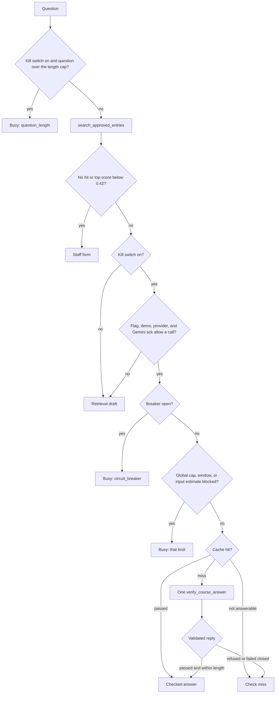

# Study-agent orchestration

This note describes the policy pipeline on this branch (`main` at the commit
that merged pull request 121). It sits between local retrieval and the single
model call. The numbers below were read from the modules named in each row.
The rationale column is the reason written in `docs/AGENT_POLICY.md`, not a
new measurement.

## Purpose

`run_study_agent` in `backend/app/ai/agent_policy.py` is the only study-agent
entry. `answer_from_knowledge_base` in `backend/app/services/kb_agent_service.py`
calls it. The pipeline does not let the model pick an action, call a tool, or
loop. It retrieves approved course material, applies a fixed cutoff and a
fixed set of guards, makes at most one checker invocation, checks that reply,
and returns one of four API outcomes.

Retrieval is local. The checker, when it is allowed to run, is Gemini or
Claude through `verify_course_answer` in `backend/app/ai/claude_client.py`.

## Fixed pipeline

1. If the kill switch is on and the question is longer than the question-length cap, return busy. Retrieval does not run.
2. Call `search_approved_entries` with the request's `top_k`, `course_id`, `approved_only`, `course_scoped`, and `course_material_only=True`. The search include threshold stays `DEFAULT_SEARCH_THRESHOLD` (0.35). This function does not receive 0.42.
3. If there is no hit, or the top similarity is below `WEAK_MATCH_CONFIDENCE` (0.42), return the staff form. The model is not called.
4. If the kill switch is off, return the retrieval draft. The model is not called, the cache is not read, and no budget slot is spent.
5. If the external-call flag, demo mode, provider, or Gemini acknowledgement blocks a call, `verify_course_answer` records that guard and the retrieval draft is returned. No budget slot is spent.
6. If the circuit breaker is open, return busy.
7. If the global call cap, the global token cap, a sliding window, or the input-token estimate blocks the call, return busy. The cache is not consulted.
8. If the cache holds this question and these chunks, return the stored decision and do not call the model.
9. Record the per-user and per-course windows together. If one is full, record none and return busy.
10. Call `verify_course_answer` once. Inside that call, a `TimeoutError` or `urllib.error.URLError` is tried a second time (`ANSWER_CHECK_ATTEMPTS` is 2). That is still one pipeline step.
11. Validate the reply. A pass within the answer-length cap becomes the checked answer. A model refusal, a failed check, or an over-long answer becomes the check-miss text. The retrieval draft is not used.



## Outcomes and the text each one returns

`OUTCOMES` in `agent_policy.py` is `answer`, `refuse`, `staff`, `busy`.
The HTTP body is an `AgentAskResponse`. The Study Agent page does not show
every one of those strings. See the last row.

| API outcome | Record `outcome` | What `POST /agent/ask` puts in `answer` | `should_seek_help` | `matched_count` |
| --- | --- | --- | --- | --- |
| Answer | `passed`, or a cache hit of `passed` | The checker's `answer`, a newline, then `based on <file>, p.<page> approved by the professor` when the chunk has a file and a page. Built by `_checked_answer`. The quote is not appended. | false | 1 |
| Refuse, including every failed check | `not_answerable`, `invalid_json`, `unfaithful`, `unknown_chunk`, `api_error`, `rate_limited`, `daily_quota`, `answer_too_long`, or a cache hit of `not_answerable` | `I couldn't confirm an answer in the approved course material.` (`CHECK_MISS_ANSWER`) | true | 0 |
| Staff | `below_cutoff` | `I don't have professor-approved course material that answers this yet — guessing would waste your time.` followed by the Quiet-ask paragraph (`NO_MATCH_ANSWER`) | true | 0 |
| Busy | `quota` or `busy` | `The study assistant is busy right now, so I will not guess from the notes.` followed by the Quiet-ask line (`BUSY_ANSWER`) | true | 0 |
| Not one of the four. Kill switch off, or a guard blocked the call | `disabled`, `flag_off`, `demo_off`, `provider_off`, `ack_off` | `Based on professor-approved course knowledge — <file>, p. <page>, chunk <n>:` then the approved chunk text. Other hits are listed as `Related approved material` with a match percent (`_retrieval_answer`). | false | number of hits |

On the Study Agent page, `frontend/officehours-app/src/pages/StudentAgentPage.jsx`
replaces the reply with `No professor-approved material answers this.` when
`should_seek_help` is true or `matched_count` is 0, and it drops the sources.
Busy, the staff form, a model refusal, and a failed check all take that
branch. A checked answer and a retrieval draft do not, because those responses
have `should_seek_help` false and a non-zero `matched_count`.

`scripts/demo_orchestration.py` calls `run_study_agent` with a fake client.
Its table is the API outcome, not the sentence the page substitutes.

## Controls

Defaults were printed on 28 October 2026 (Africa/Casablanca) by importing the
module with `OFFICEHOURS_LLM_ENABLED`, `OFFICEHOURS_ALLOW_EXTERNAL_LLM`,
`OFFICEHOURS_DEMO`, `OFFICEHOURS_LLM_PROVIDER`, `OFFICEHOURS_GEMINI_FREE_TIER_ACK`,
and `GEMINI_MODEL` unset. A missing, blank, non-numeric, or non-positive
integer falls back to the default inside `_positive_int`. The "why" cell is
the reason in `docs/AGENT_POLICY.md`.

| Name | Environment variable | Default printed | Why that value | Where it is enforced |
| --- | --- | --- | --- | --- |
| Kill switch | `OFFICEHOURS_LLM_ENABLED` | false (`llm_enabled`) | Off leaves the retrieval path. A key alone does not call the model. | `llm_enabled`; `run_study_agent` |
| Question length | `OFFICEHOURS_LLM_MAX_QUESTION_CHARS` | 2000 | A study question, not a pasted chapter. The HTTP schema still allows 4000 characters. | `max_question_chars`; `run_study_agent` before search |
| Chunks sent | `OFFICEHOURS_LLM_MAX_CHUNKS` | 3 | The checker cites one chunk. Three is the top-k the quote check was built for. | `max_chunks`; `run_study_agent`. `_material_chunks` also keeps the first 3 |
| Input estimate | `OFFICEHOURS_LLM_MAX_INPUT_TOKENS` | 3000 | Three chunks plus the prompt were expected near 1,500 tokens. 3,000 refuses a pathological paste. | `estimate_input_tokens`; `run_study_agent` |
| Output cap | `OFFICEHOURS_LLM_MAX_OUTPUT_TOKENS` | 400 | One small JSON object. | `max_output_tokens`, passed by `GeminiAnswerCheckClient.complete` and `AnthropicAnswerCheckClient.complete` |
| Answer length | `OFFICEHOURS_LLM_MAX_ANSWER_CHARS` | 600 | A longer body was not validated line by line, so it is refused rather than truncated. | `run_study_agent` rewrites a pass to `answer_too_long` |
| Timeout | `OFFICEHOURS_LLM_TIMEOUT_SECONDS` | 10 | A study question should return while the student is still on the page. | `timeout_seconds`, passed into the provider client |
| Per user, per minute | `OFFICEHOURS_LLM_USER_PER_MINUTE` | 4 | A few rephrases, not a script. | `_window_checks`; `RateLimiter` in `run_study_agent`. Only if `user_id` is set |
| Per user, per day | `OFFICEHOURS_LLM_USER_PER_DAY` | 30 | One study session. | same window list. Only if `user_id` is set |
| Per course, per day | `OFFICEHOURS_LLM_COURSE_PER_DAY` | 150 | The fixed eval is 75 questions. 150 covers that run plus one rerun. | `_window_checks` when `course_id` is set |
| Global calls | `OFFICEHOURS_LLM_GLOBAL_CALLS_PER_DAY` | 200 | A demo day, above one eval and below an open retry loop. | `_budget_block`; `_note_spend` |
| Global tokens | `OFFICEHOURS_LLM_GLOBAL_TOKENS_PER_DAY` | 200000 | Trips before the call cap if prompts grow toward the input cap. | `_budget_block`; `_note_spend` |
| Breaker failures | `OFFICEHOURS_LLM_BREAKER_FAILURES` | 3 | Three failed-closed results in a row. A pass and `not_answerable` reset the counter. | `_note_failure`; `breaker_open` |
| Breaker open time | `OFFICEHOURS_LLM_BREAKER_MINUTES` | 5 | Stops a tight retry loop and leaves room to continue a demo. | `_note_failure` |
| Cache TTL | `OFFICEHOURS_LLM_CACHE_TTL_SECONDS` | 3600 | About a lecture hour. Approval changes drop the row immediately. | `_cache_get` |
| Answer cutoff | none. Constant `WEAK_MATCH_CONFIDENCE` | 0.42 | Kept from the retrieval baseline. This note does not change it. | `run_study_agent` after search |
| Search include threshold | none. Constant `DEFAULT_SEARCH_THRESHOLD` | 0.35 | Hits between 0.35 and 0.42 can be retrieved and are still staffed by the 0.42 rule. | `search_approved_entries` |
| Prompt version | none. Constant `PROMPT_VERSION` | `study-answer-check-v1` | Cache identity. | `_cache_key` |
| Checker attempts | none. Constant `ANSWER_CHECK_ATTEMPTS` | 2 | One retry for a dropped connection inside the single invocation. | `verify_course_answer` |
| Gemini model | `GEMINI_MODEL` | `gemini-3.5-flash-lite` | Provider default in `gemini_client.py`. | `gemini_model` |
| External flag | `OFFICEHOURS_ALLOW_EXTERNAL_LLM` | unset, treated as off | A call needs an explicit flag. | `_model_calls_allowed`; `_external_llm_allowed` |
| Demo mode | `OFFICEHOURS_DEMO` | unset, treated as off | Course text is not sent outside demo mode. | `demo_mode`; `verify_course_answer` |
| Provider | `OFFICEHOURS_LLM_PROVIDER` | unset, not ready | Must be `gemini` or `claude` for a live call. | `_provider_ready`; `verify_course_answer` |
| Free-tier acknowledgement | `OFFICEHOURS_GEMINI_FREE_TIER_ACK` | unset, treated as off | Gemini's free tier may use prompts to improve Google products. | `_provider_ready`; `verify_course_answer` |

`OFFICEHOURS_RATE_LIMIT=false` does not change this table. The policy uses its
own `RateLimiter` instance, and `blocking` / `allow_all` do not read that
flag. The HTTP limiter is separate: `DEFAULT_LIMITS` in
`backend/app/services/rate_limit.py` includes `/agent/ask` at 40 requests
per 60 seconds, and `rate_limit_enabled` skips that HTTP limiter when the
flag is false.

The global counters use the UTC date in `_roll_budget`. They live in the
process. A restart clears them. The sliding windows are also in that process.

## Guards, in the order they are checked

A live call needs every item. The first failure wins.

1. `OFFICEHOURS_ALLOW_EXTERNAL_LLM` is true. Otherwise `flag_off`.
2. `OFFICEHOURS_DEMO` is true. Otherwise `demo_off`.
3. An injected `answer_checker` skips the next two. Without one, `OFFICEHOURS_LLM_PROVIDER` must be `gemini` or `claude`. Otherwise `provider_off`.
4. For Gemini, `OFFICEHOURS_GEMINI_FREE_TIER_ACK` must be true. Otherwise `ack_off`.

`run_study_agent` asks `_model_calls_allowed` and `_provider_ready` before it
spends a slot. If either is false it still calls `verify_course_answer`, which
returns the guard and does not build a live client. The retrieval draft is
what the student API returns. An injected client does not bypass the external
flag or demo mode, because those are checked first inside `verify_course_answer`.

## What is logged, and what is not

One info line, logger `officehours.agent_policy`:

```text
agent_policy outcome=%s model=%s latency_ms=%.1f input_tokens=%s output_tokens=%s limit=%s
```

`_log` keeps these outcome names: `answered`, `refused_by_model`,
`failed_closed_error`, `quota`, `busy`, `cache_hit`, `staff`, `disabled`,
`flag_off`, `demo_off`, `provider_off`, `ack_off`. Any other name is written
as `failed_closed_error`. A pass is logged as `answered`. A model refusal is
logged as `refused_by_model`.

`limit` is `question_length`, `input_tokens`, `user_per_minute`,
`user_per_day`, `course_per_day`, `global_calls`, `global_tokens`,
`circuit_breaker`, `answer_length`, `kill_switch`, the guard name, or `-`.

The line does not contain the question, the chunk text, the short answer, the
quote, a user id, a name, an email, or an API key. Cache hits and budget
refusals log zero tokens because nothing was sent.

Separate warnings exist and are not that line. `verify_course_answer` warns
on `demo_off`. `_warn_missing_gemini_ack` warns when the acknowledgement is
missing. Transport retries log `answer_check transport_error`. The Gemini
client logs its own retry and quota warnings. `run_study_agent` calls the
checker with `emit_log=False`, so the `answer_check outcome=` info line is
not emitted on this path.

## Cache

Key: SHA-256 of the course id (or `-`), the question with case folded and
internal whitespace collapsed, `chunk_id:status` for each chunk sent, the
configured model name, and `study-answer-check-v1`. There is no user id.

Stored only for `passed` and `not_answerable`: the decision, the short answer,
the quote, the cited chunk id, the model name, and the chunk ids. Errors,
quota stops, busy stops, and guard results are not stored.

A row is dropped when its TTL passes, when `update_entry` changes `status` or
`answer_draft`, or when `_stamp_upload` approves or rejects an upload. Both
call `invalidate_chunks`. A full window is checked before the cache, so a
student who is over a cap does not receive a cached answer. Another student
is not charged for that lookup.

## Failure behavior

A failed check returns `CHECK_MISS_ANSWER` and does not fall back to the
retrieval draft. The draft is unreviewed by the checker. Showing it after a
bad quote, bad JSON, or a provider error would present course text the check
did not accept. Busy does the same: it does not guess from the notes.

The retrieval draft is returned only when the kill switch is off or a guard
stops the call before a model request.

Inside the Gemini client, HTTP 429 and 503 are retried up to
`RATE_LIMIT_ATTEMPTS` (3) with sleeps of 1 second and 2 seconds. A daily quota
is not retried. Exhausted 429/503 retries raise `RateLimitExhausted`, which
the outer gate records as `rate_limited` and does not send again. A missing
`GEMINI_API_KEY` raises `RuntimeError` before the request. The outer gate
does not retry that. `TimeoutError` and any `URLError` that leaves the client
are retried once by `verify_course_answer`. `urllib.error.HTTPError` is a
subclass of `URLError`. The Gemini client catches `HTTPError` itself. An
HTTP error that the client re-raises can still be retried once by the outer
gate.

## Free-tier data-use constraint

`gemini_client.py` states that the Gemini free tier may use prompts to
improve Google products, and that only synthetic demo data may be sent. A
Gemini call also needs `OFFICEHOURS_GEMINI_FREE_TIER_ACK=true`,
`OFFICEHOURS_ALLOW_EXTERNAL_LLM=true`, and `OFFICEHOURS_DEMO=true`. Claude
does not read the Gemini acknowledgement. This repository does not, in this
note, restate Google's current terms beyond the warning in that module.

## What the model is not allowed to do

The model does not choose the next step. The code does. It does not call
tools, search again, or write a second prompt. The pipeline invokes the
checker once. The only extra `complete` is the single transport retry inside
that invocation, or the Gemini client's own 429/503 retries inside that same
invocation.

The checker receives at most three chunks, as JSON data under a system
instruction that the question and the chunks are data. `answerable` must be
a boolean. The string `"true"` is `invalid_json`. `supporting_chunk_id` must
be one of the sent ids. `quote` must be a non-empty exact substring of that
chunk. The quote is evidence for the program. It is not shown to the student.

## Known limits and open decisions

The quote check proves the quote occurs in the cited chunk. It does not prove
that the short answer adds no facts. `_checked_answer` displays `answer`
after checking that it is a non-empty string. It does not test entailment.

The cache, the breaker, and the global day counters are memory inside one
process. They are not shared across processes and they disappear on restart.

The token estimate is characters divided by four, not the provider's
tokenizer. The global token cap later uses the provider's reported counts.

The Study Agent page collapses busy, staff, refusal, and failed-closed into
one sentence. A demo that needs those four strings has to read the API body
or the policy log.

`HTTPError` being a `URLError` means some HTTP failures are eligible for the
outer retry even though the policy text describes that retry as a dropped
connection.

The saved Gemini run is one model, one prompt version, and one pass over the
75 agent-generated questions. This pipeline does not repeat a question to
estimate variance.

No independent human-written question set is in the saved with-check file
(`human_written.n` is 0).
